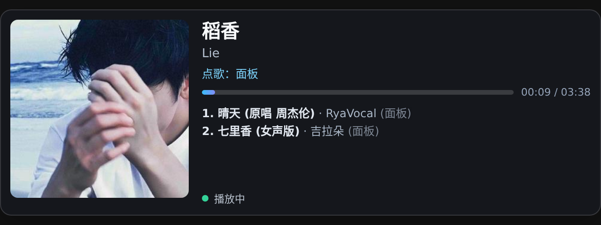
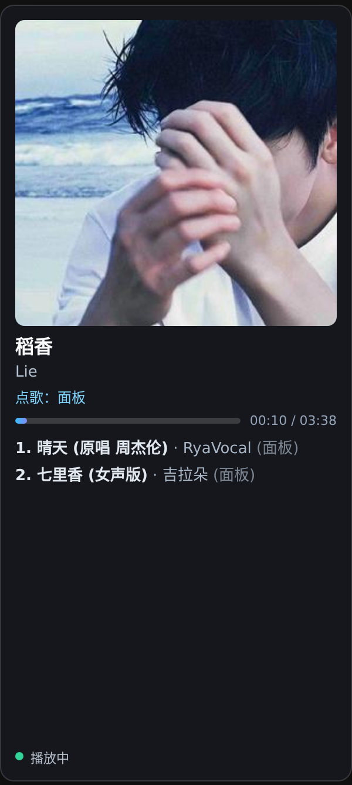
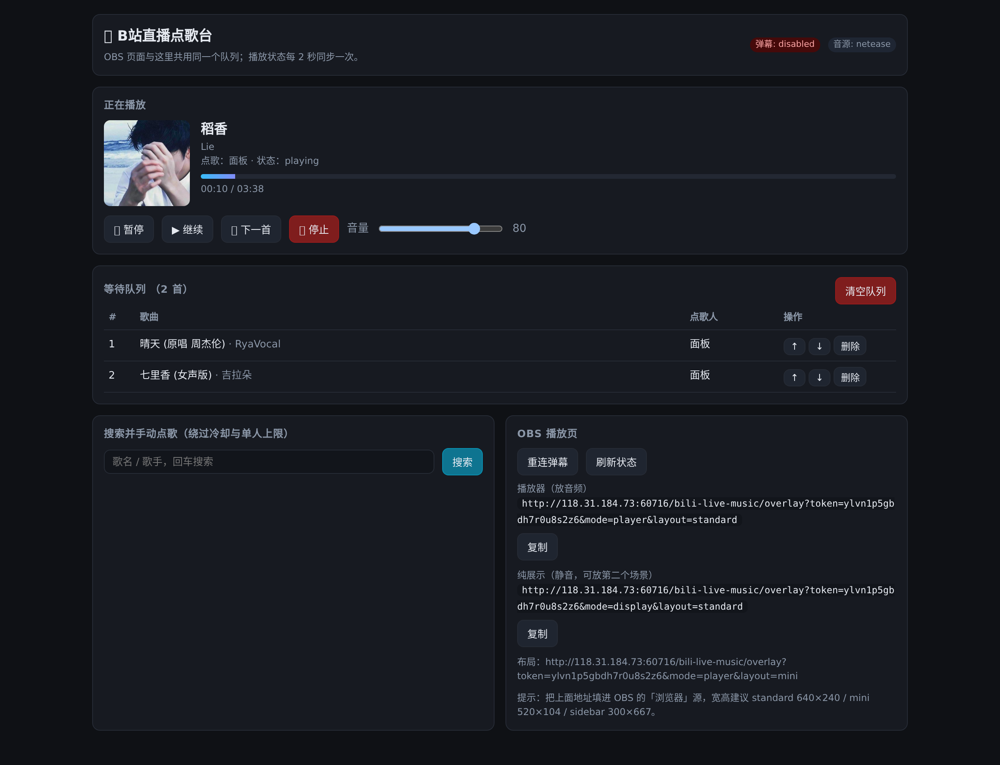

# 🎵 astrbot_plugin_bili_live_music

> B站直播间**弹幕点歌**，多音源搜索 + 队列管理 + **OBS 播放层**（3 种布局）+ 控制面板。
> 思路来自 Koishi 插件 [koishi-plugin-bili-live-music](https://github.com/VincentZyuApps/koishi-plugin-bili-live-music)，
> 用 Python 为 AstrBot 重写。

---

## ✨ 功能

- 📡 **B 站弹幕监听**：观众发 `点歌 歌名` 即入队；匿名即可连公开直播间；断线按 1/2/4/8/16/32 秒退避重连，旧连接迟到的消息会被丢弃
- 🎵 **多音源**：
  - `netease`（默认）：网易云搜索 + 第三方直链节点，**节点自动回退 + 直链可用性校验**
  - `luoyue`：落月 API，同时启用 网易云 / QQ音乐 / 酷狗，多平台并行搜索、交替合并；酷狗支持 hash 参数降级
- 📋 **点歌限制**：单曲时长上限、单观众同时排队上限、队列总长、点歌冷却、同曲去重
- 🖥️ **OBS 播放层**：独立 aiohttp 服务（默认 `60716`），`mini / standard / sidebar` 三种布局；
  OBS 浏览器源打开即播放音频，WebSocket 实时同步歌曲/进度/队列
- 🎛️ **控制面板**：队列增删/排序、搜索点歌、暂停/下一首/音量、弹幕重连、一键复制 OBS 地址
- 💬 **QQ 命令**：`/点歌 歌名`；管理员 `/点歌 状态|跳过|清空|暂停|继续|音量|面板|重连`
- 🧪 **模拟弹幕**：面板里直接“发一条弹幕”走真实的解析→搜歌→入队→播放流程，**不开播、没有观众也能验收**
- 🔑 **凭据可借用**：`bilibili_cookie` 留空时自动借用 `astrbot_plugin_bilibili` 已登录的凭据（公开直播间其实不需要）
- 💾 **状态持久化**：等待队列/历史/音量落盘，重启后恢复；上次没播完的放回队首
- 🛡️ **健壮性**：加载超时自动跳过坏歌、播放报错自动跳过、直链失效换候选、面板操作异常不影响播放

## 📸 效果预览

OBS 播放层（standard 640×240，实拍自服务器上的真实播放状态）：



mini（520×104）与 sidebar（300×667）：




控制面板（队列 / 搜索点歌 / 音量 / OBS 地址一键复制）：



## 🏗 架构：为什么音频在 OBS 里播

```
B站弹幕 ──► DanmakuService ──► QueueManager ──► PlayerService ──► OverlayHub ──WS──► OBS 页面(<audio>)
                                      ▲                │                                   │
                                 控制面板 ◄────────────┴──────── 进度/结束/错误 ◄───────────┘
```

AstrBot 通常跑在**云端服务器**上（没有声卡），所以音频不能由服务器播放，而是由
**OBS 浏览器源**在主播电脑上播放；服务器只负责"排什么歌、放到第几首、进度多少"。
这也是原 Koishi 插件推荐的 `browser` 模式。VLC 后端因此不实现。

## 🔧 弹幕传输层说明

B 站弹幕的 WebSocket **没有**用 `bilibili_api` 的 `LiveDanmaku`：它底层是 **curl_cffi**，
在部分容器环境里收到消息会 C 层 `Aborted`（整个进程挂掉，实测必现）。
本插件改用 `core/bili_ws.py`（aiohttp 实现）：HTTP 接口（房间号/弹幕服务器 token）仍复用
`bilibili_api` 以通过 wbi 签名与风控，只把 WebSocket 和协议解析换成纯 Python。

另外 B 站的压缩帧解压后仍是「16 字节包头 + JSON」的序列，解析时必须再按包头切一次包，
否则会"连上了却一条弹幕都收不到"。

## 📦 安装

1. 安装依赖（容器内一般已有 aiohttp；缺 `bilibili-api-python` 时装一下）：

```bash
pip install bilibili-api-python aiohttp
```

2. 把插件目录放到 `AstrBot/data/plugins/astrbot_plugin_bili_live_music`，重载插件。
3. 在插件配置里填 `room_id`（直播间链接末尾的数字）。
4. 浏览器打开控制面板：`http://<服务器IP>:60716/bili-live-music/?token=<obs_access_token>`
5. OBS 新建「浏览器」源，地址填面板里「播放器」那条，宽高按布局设置（standard 640×240），
   勾选「通过 OBS 控制音频」。

## ⚙️ 配置（关键项）

| 配置项 | 默认 | 说明 |
|---|---|---|
| `room_id` | 0 | B 站直播间号 |
| `enable_danmaku` | true | 是否启动弹幕监听 |
| `command_prefix` | 点歌 | 弹幕前缀 |
| `bilibili_cookie` | 空 | 受限直播间才需要；公开直播间留空即可 |
| `borrow_bilibili_cookie` | true | 留空时自动借用 bilibili 插件的登录凭据 |
| `music_backend` | netease | `netease` 或 `luoyue` |
| `netease_direct_api` | 4 个节点 | 网易云直链节点，按顺序回退 |
| `luoyue_api_base` / `luoyue_sources` | vkeys / netease,tencent | 落月 API 地址与启用音源 |
| `verify_music_url` | true | 取到直链后先验证能下载 |
| `max_queue_size` / `per_user_limit` / `cooldown` | 30 / 3 / 25s | 队列限制 |
| `max_duration` | 600000ms | 单曲时长上限 |
| `playback_load_timeout` | 25s | 加载超时自动跳过 |
| `obs_server_port` | 60716 | Overlay/面板端口 |
| `obs_public_host` | 127.0.0.1 | 生成地址用的主机（OBS 在主播电脑上填服务器 IP/域名） |
| `obs_access_token` | test12345 | **务必改掉**，面板/OBS 地址都靠它 |
| `overlay_layout` | standard | mini / standard / sidebar |
| `bot_request_enabled` | false | 是否允许非管理员在 QQ 点歌 |

## 💬 命令

| 命令 | 权限 | 说明 |
|---|---|---|
| `/点歌 歌名` | 管理员；或 `bot_request_enabled=true`（可配白名单） | 点歌 |
| `/点歌 状态` | 管理员 | 当前播放 + 队列 + 弹幕状态 |
| `/点歌 跳过` | 管理员 | 跳过当前 |
| `/点歌 清空` | 管理员 | 清空等待队列（不影响当前） |
| `/点歌 暂停` / `/点歌 继续` | 管理员 | 暂停/继续 |
| `/点歌 音量 60` | 管理员 | 0-100 |
| `/点歌 面板` | 管理员 | 返回面板与 OBS 地址（含令牌，建议私聊用） |
| `/点歌 重连` | 管理员 | 重连弹幕 |

## 🧪 测试

```bash
python tests/test_queue.py
python tests/test_music.py
python tests/test_danmaku.py
python tests/test_player.py
python tests/test_panel_overlay.py
```

全部为纯本地单测（假 HTTP / 假客户端 / aiohttp 回环服务器），不联网、不需要 AstrBot 运行时。

## ❓ 常见问题

**Q：点了歌但 OBS 没声音？**
1. OBS 源是不是「播放器」（`mode=player`）那条地址？展示页（`mode=display`）是静音的。
2. 源属性里勾选「通过 OBS 控制音频」。
3. 面板上「正在播放」有进度但无声音 → 检查直链（`verify_music_url=true` 会提前挡掉坏链）。

**Q：弹幕连不上？**
看日志 `弹幕连接[xxx] -> ...`。公开直播间一般匿名可连；受限直播间需要填 `bilibili_cookie`。

**Q：提示「拿不到播放地址」？**
第三方直链节点挂了。网易云可换 `netease_direct_api` 里的节点；或改用 `music_backend=luoyue`。

**Q：服务器重启后队列还在吗？**
等待队列、历史、音量会恢复；正在播的那首会放回队首重新播。

**Q：还没开播 / 没有观众，怎么测试？**
打开控制面板 → 「模拟弹幕（测试用）」→ 输入 `点歌 晴天` → 发一条。
它会走真实的「前缀解析 → 搜歌 → 直链校验 → 入队 → 通知 OBS 播放」流程，
OBS 页面开着就能直接看到歌开始放。

## 🙏 致谢

- [koishi-plugin-bili-live-music](https://github.com/VincentZyuApps/koishi-plugin-bili-live-music)：原始设计与交互参考
- [bilibili-api-python](https://github.com/Nemo2011/bilibili-api)：弹幕 WebSocket 封装
- [AstrBot](https://github.com/AstrBotDevs/AstrBot)：插件框架
